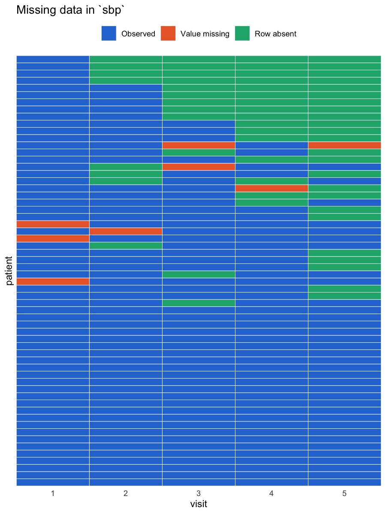

<!-- README.md is generated from README.Rmd. Edit README.Rmd, then run devtools::build_readme(). -->

# gapwise

gapwise is an R package for data in which the same units are measured
more than once: patients at follow-up visits, hospitals by month,
countries by year. It finds the observations that are missing from such
data, makes them visible, and creates lagged variables that stay correct
when observations are missing.

## The problem it solves

Suppose two patients were each meant to attend four visits.

| patient | visit | blood pressure |
|---------|-------|----------------|
| A       | 1     | 120            |
| A       | 2     | 125            |
| A       | 3     | 130            |
| A       | 4     | 128            |
| B       | 1     | 140            |
| B       | 2     | 138            |
| B       | 4     | 150            |

Patient B did not attend visit 3, so the table simply has one row fewer.
Nothing in the data says that an observation is missing. In a file with
thousands of rows this goes unnoticed, and it causes two kinds of error.

1.  **Missing data are undercounted.** Counting `NA` values finds none,
    even though one of eight planned measurements was never taken.
2.  **Lagged variables are wrong.** Many analyses use the value from the
    previous time point. The usual code takes the value from the row
    above. For patient B at visit 4, the row above is visit 2, so 138 is
    recorded as the previous blood pressure. The true previous value, at
    visit 3, is unknown.

gapwise has one function for each step of dealing with this.

| Function | What it does |
|----|----|
| `check_panel()` | Reports duplicated rows, absent rows, and whether the data are complete |
| `fill_panel()` | Adds the absent rows, with `NA` for the values that were not measured |
| `add_lag()` | Adds a lagged variable matched on the time value, not the row above |
| `miss_by_time()` | Counts missing values for each variable at each time point |
| `plot_missing()` | Draws which units are missing a variable at which time points |
| `attrition()` | Counts how many units are still observed at each time point |

## Installation

Install the package from GitHub:

``` r
# install.packages("remotes")
remotes::install_github("Jimmuji/gapwise")
```

Then load it:

``` r
library(gapwise)
```

## How to call the functions

Every function takes the data first, then the names of two columns, in
quotes:

- `id` is the column that says which unit a row belongs to.
- `time` is the column that says which time point a row belongs to.

The data must be in long format, meaning one row per unit and time
point.

## Example data

Two data sets come with the package, so every example below runs as
shown.

- `visits` is a simulated cohort of 60 patients who were each meant to
  attend 5 visits. Some patients drop out, some skip a visit, and some
  measurements were not recorded.
- `conflict` has one row per country and year for 186 countries from
  2000 to 2019, with armed conflict and mortality indicators.

``` r
head(visits)
#>   patient visit    sex sbp weight
#> 1    P001     1 Female 138   96.5
#> 2    P001     2 Female 141   93.1
#> 3    P001     3 Female 135   93.5
#> 4    P001     4 Female 124   95.1
#> 5    P001     5 Female 120   92.8
#> 6    P002     1 Female 124   79.4
```

## A worked example

### 1. Check the structure

``` r
result <- check_panel(visits, id = "patient", time = "visit")
result
#> Units (patient): 60
#> Time points (visit): 5 (1, 2, 3, 4, 5)
#> Rows: 240 found, 300 expected
#> Balanced: no
#> Duplicated combinations: 0
#> Absent rows: 60 (before first: 0, gap: 9, after last: 51)
#> Rows with a missing patient or visit: 0
#> See $duplicates and $absent for the rows involved.
```

Sixty patients and five visits should give 300 rows, but there are 240.
Of the 60 absent rows, 9 are gaps (the patient came back later) and 51
fall after the patient’s last visit.

The absent rows are listed in `result$absent`:

``` r
head(result$absent)
#>   patient visit   position
#> 1    P002     3        gap
#> 2    P003     4 after last
#> 3    P003     5 after last
#> 4    P006     3 after last
#> 5    P006     4 after last
#> 6    P006     5 after last
```

By default the expected time points are the ones that appear somewhere
in the data. If you know what they should be, pass them in `times`, for
example `times = 1:5`. This also catches a time point that every unit is
missing.

### 2. Make the absent rows visible

``` r
filled <- fill_panel(visits, id = "patient", time = "visit", constant = "sex")
nrow(filled)
#> [1] 300
filled[filled$patient == "P002", ]
#>    patient visit    sex sbp weight
#> 6     P002     1 Female 124   79.4
#> 7     P002     2 Female 127   78.7
#> 8     P002     3 Female  NA     NA
#> 9     P002     4 Female 143   77.3
#> 10    P002     5 Female 129   80.5
```

Patient P002 now has a row for visit 3 with `NA` measurements. Columns
listed in `constant` do not change within a unit, so they are copied
into the new row instead of being left empty.

### 3. Lag a variable safely

Here is the row-above approach applied to patient P002, followed by
`add_lag()`.

``` r
p002 <- visits[visits$patient == "P002", c("patient", "visit", "sbp")]

# the row above: wrong at visit 4
p002$row_above <- c(NA, head(p002$sbp, -1))

# matched on the visit number: correct
p002 <- add_lag(p002, var = "sbp", id = "patient", time = "visit")
p002
#>   patient visit sbp row_above sbp_lag1
#> 6    P002     1 124        NA       NA
#> 7    P002     2 127       124      124
#> 8    P002     4 143       127       NA
#> 9    P002     5 129       143      143
```

At visit 4 the row-above column reports 127, which was measured at visit
2. `add_lag()` looks for visit 3, finds no row, and returns `NA`.

`add_lag()` works within each unit, so a value is never carried from the
end of one unit to the start of the next. The rows do not need to be
sorted, and they are returned in their original order. Use `n` for
longer lags, for example `n = 2`.

### 4. See where values are missing

`miss_by_time()` separates the two reasons a value can be missing: the
unit has no row at that time point (`n_absent`), or the row is there but
the value is `NA` (`n_na`).

``` r
miss_by_time(visits, id = "patient", time = "visit", vars = "sbp")
#>   variable visit n_units n_absent n_na n_missing pct_missing
#> 1      sbp     1      60        0    3         3         5.0
#> 2      sbp     2      60        8    1         9        15.0
#> 3      sbp     3      60       12    2        14        23.3
#> 4      sbp     4      60       16    1        17        28.3
#> 5      sbp     5      60       24    1        25        41.7
```

Counting `NA` values in the original data would report 8 missing blood
pressure readings. The true number is 68.

`plot_missing()` shows the same information for each patient.

``` r
plot_missing(visits, var = "sbp", id = "patient", time = "visit")
```



### 5. Count who is still in the study

``` r
attrition(visits, id = "patient", time = "visit")
#>   visit n_units n_observed pct_observed n_dropped_after
#> 1     1      60         60        100.0               4
#> 2     2      60         52         86.7               5
#> 3     3      60         48         80.0               5
#> 4     4      60         44         73.3              10
#> 5     5      60         36         60.0               0
```

`n_dropped_after` is the number of patients seen at that visit and never
again. Add `var = "sbp"` to count a patient as observed only when blood
pressure was actually recorded.

## The same functions on country data

Nothing in the package is specific to patients. With `conflict`, the
unit is the country and the time point is the year.

``` r
check_panel(conflict, id = "iso", time = "year")
#> Units (iso): 186
#> Time points (year): 20 (2000, 2001, 2002, 2003, 2004, 2005, ... , 2019)
#> Rows: 3720 found, 3720 expected
#> Balanced: yes
#> Duplicated combinations: 0
#> Absent rows: 0
#> Rows with a missing iso or year: 0
```

No rows are absent, but that does not mean no values are missing:

``` r
mm <- miss_by_time(conflict, id = "iso", time = "year", vars = "matmor")
tail(mm, 4)
#>    variable year n_units n_absent n_na n_missing pct_missing
#> 17   matmor 2016     186        0    3         3         1.6
#> 18   matmor 2017     186        0    3         3         1.6
#> 19   matmor 2018     186        0  186       186       100.0
#> 20   matmor 2019     186        0  186       186       100.0
```

The maternal mortality ratio is missing for all 186 countries in 2018
and 2019, which shortens any analysis of it by two years.

A lagged exposure, here armed conflict in the previous year:

``` r
lagged <- add_lag(conflict, var = "armedconflict", id = "iso", time = "year")
head(lagged[, c("iso", "year", "armedconflict", "armedconflict_lag1")], 3)
#>   iso year armedconflict armedconflict_lag1
#> 1 AFG 2000             1                 NA
#> 2 AFG 2001             1                  1
#> 3 AFG 2002             1                  1
```

## Getting help

Every function and both data sets have a help page with examples:

``` r
?check_panel
?add_lag
help(package = "gapwise")
```

If a function stops with an error about duplicated rows or missing
values in `id` or `time`, run `check_panel()` first. It reports those
problems instead of stopping.

## Authors

Jim Wang. Written as the final project for CHL5233H, Statistical
Programming and Computation for Health Data, at the University of
Toronto.

## License

MIT
